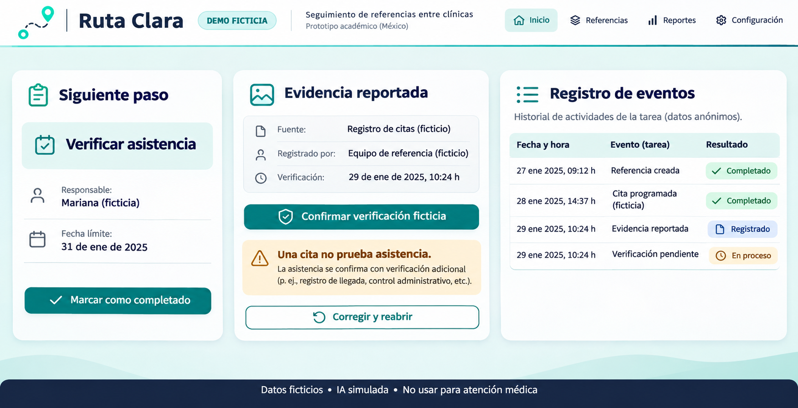
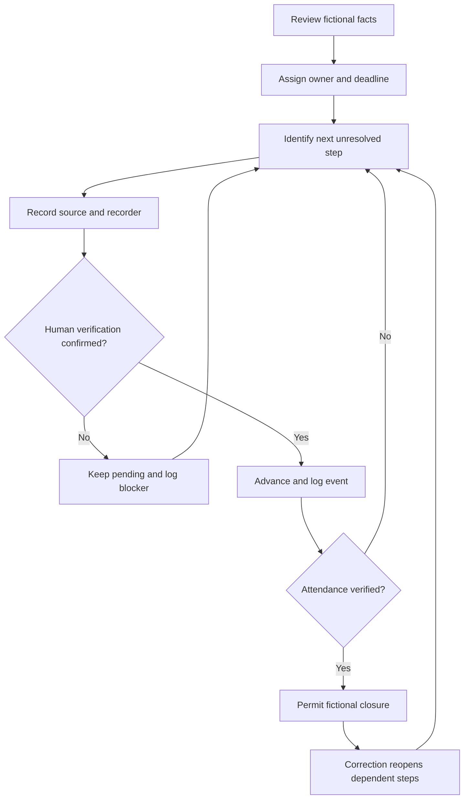
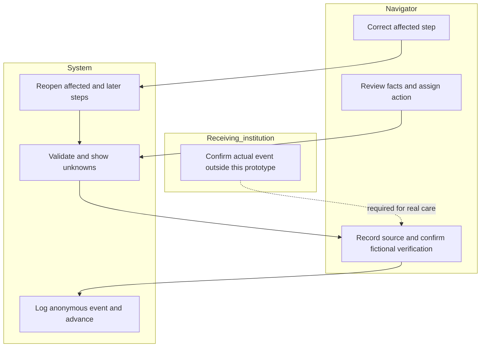

# Ruta Clara | Week 13 build packet
Fernanda Espinosa | TECHNOLOGIST | 5 November 2026

## Authority and evidence boundary
Written before Week 13 implementation. Inputs: supplied Week 13 Technologist Brief and Team Blueprint; current Week 12 Packet status page and recovered Vercel source. Ruta Clara remains Fernanda's declared individual slice although SkillProof is the team's primary bet. The exact Crystal Ball Brief is unavailable. No human study, fresh-chat persona session, real attendance or savings is claimed.

## Problem and exact user
A referral navigator in a Mexican clinic cannot reliably distinguish a recorded action from a verified handoff. The beneficiary otherwise makes repeated calls. This fictional academic workflow tests whether a navigator can identify and correct the next unresolved step without mistaking an appointment or message for attendance.

## Success before module close
The existing Next.js prototype runs on the same Vercel project, preserves email access and fictional-session saving, adds an anonymous session event log and JSON export, captures evidence origin plus recording/verification attribution, and prevents unattended completion. Correction reopens affected downstream steps. At least five meaningful commits and two Week 13 deployments must be evidenced. Synthetic checks do not satisfy five-user validation.

## Image-generated mockup

Generation requested before implementation; embed the completed asset in the PDF. Decorative labels or layouts are conceptual, not acceptance evidence.

## Flow

## Actor swimlane

## Global benchmark
My strongest selected existing benchmark is Unite Us Closed-Loop Referral System, which tracks referrals and service-specific outcomes beyond sending (not an independently established world ranking). Mine localizes a bounded Spanish-language Mexican clinic workflow with explicit unknowns, responsible review and correction; it does not reproduce its network or integrations.
Official source checked 5 November 2026: https://uniteus.com/products/closed-loop-referral-system/

## Three-year long view
If this slice works, Ruta Clara becomes a protected referral layer for a funded Mexican navigation network. Evidence provenance, receiving capacity and correction ownership remain visible across institutions. Expansion depends on measured improvement over the current workaround, authorized human verification and sustainable support, rather than adding AI by default.

## Scope cut
No real patient data, clinical advice, patient enrollment, live messaging, appointment booking, hospital directory, certification or automated closure. AI extraction remains visibly simulated. Format checks cannot prove that a person attended; all demo verifiers and evidence are fictional and self-attested. No measured 10:1 claim.

## Architecture and stack
| Layer | Existing / planned Week 13 behavior |
| --- | --- |
| UI | React / Next.js / TypeScript / Tailwind; short Spanish labels |
| Rules | Deterministic shared JavaScript validation and transitions |
| AI | Labeled deterministic extraction simulation |
| Persistence | Existing Supabase referral_sessions; owner-restricted RLS; fictional copies only |
| Auth | Existing email-link fallback; Google Sign-In remains unmet |
| Analytics addition | Bounded in-memory event log; elapsed time, event type, step, no free text or account identifiers; user-triggered JSON export |
| Deployment | Existing Vercel project ruta-clara; same current subdomain |
| Source | Recovered local Git history; verified venture GitHub link still pending |

## Blueprint traceability
C1: observe five relevant non-classmate users, >=3 strangers, without coaching; no sessions completed here. C2: rank three observed pains by harm/blockage/effort, implement #1, retest and seek a return action; current technical fixes are not falsely described as user-ranked. C3 shadow: no provisional status becomes completed care. C4: navigator owns ambiguity and corrections; affected downstream steps reopen. C5: compare matched manual/assisted cases including setup, support and corrections; no observed ratio yet. C6: fictional clinical cases only; minimal anonymous analytics.

## Security floor and limits
No secrets in source. Preserve auth and RLS; no schema or access-policy loosening. Validate lengths, dates and enumerated events; render text through React. Invented demo data only. Google is not operational, so the exact requested auth method remains a rubric gap. In-memory event logs are diagnostic, editable and not a tamper-proof clinical audit.

## Mechanical test plan
Check valid/invalid calendar dates without throwing; missing owner/source/recorder/verification; state order; route freshness and future timestamps; message-only/appointment-only attendance; early closure; correction invalidating dependent steps; malformed saved state; event whitelist, no free text, cap and export. Actual inherited bug reproduced before changes: validDate('2026-99-01') throws Invalid time value. Record results and build/deployment IDs after execution.

## Persona test protocol - pending
Fresh chat, persona: Mariana, fictional 52-year-old clinic navigator in CDMX, paper/WhatsApp habits, reads slowly under time pressure, distrusts AI. Use ordered screenshots of the actual app: entry, review, next action, evidence, closure, correction, event log. Ask her to narrate attempts and hesitation; log exact confusion, fix worst, then show corrected screenshots. This protocol is not an executed persona test.

## Real-user protocol - pending
Recruit five people who actually navigate referrals, no classmates, >=3 strangers. Seek consent; use U1-U5 and fictional cases only. Alternate manual/app order on matched tasks. Record task completion, incorrect closures, elapsed time including setup, help, exact quotes and return action. Rank three pains, fix #1, retest. Predeclared gates: zero false closures and >=4/5 identify next action without coaching; exploratory only, not safety validation.

## Implementation prompt and commit plan
See IMPLEMENTATION_PROMPT.md. Planned order: packet before code; event mechanism; evidence review; first deploy; observed bug fix with regression; final validation and second deploy; session close, commit and push if a writable GitHub repository is available. Do not manufacture a remote, human results or a transcript.
